# Life Science Agent

## Introduktion
Dette er et Life Science AI agent projekt som er udviklet i n8n, Neo4j og OpenAI

Agenten kombinerer vector RAG og Graph RAG til at svare på spørgsmål omkring analytisk kemi og mikrobiologi

## Teknologier
- n8n
- Neo4j
- OpenAI
- Vector RAG
- Graph RAG

## Arkitektur
Life Science Agent er udviklet i n8n og anvender Neo4j som både vector database og graph database

Projektet består af 5 workflows:

1. **Data Integestion:** Indlæser en PDF, som opdeler i mindre tekststykker (chunks), genererer embeddings og gemmer dem i Neo4j.

2. **Graph Ingestion:** Bruger AI til at identificere faglige begreber og relationer i teksten, som efterfølgende gemmes i Neo4j.

3. **Vector Search Tool:** Finder relavante tekststykker vha. semantisk søgning baseret på embeddings

4. **Graph Search Tool:** Finder relavandte relationer mellem faglige begreber vha. Cypher-queries i Neo4j.

5. **Life Science Agent:** Modtager brugerens spørgsmål og anvender de to søgeværktøjer til at finde information og generere et svar.


## Datakilder

Projektet anvender lærebogen *Analytical Chemistry 2.1* af David Harvey, som er tilgængelig gennem LibreTexts. 

Bogen omhandler analytisk kemi og indeholder bl.a. beskrivelser af analysemetoder, kemiske principper og laboratorieteknikker.

PDF filen indlæses gennem n8n, hvor teksten opdeles i mindre tekststykker (chunks)

Tekststykkerne anvendes til 2 formål:

- **Vector RAG:** Teksten omdannes til embeddings, som gemmes i Neo4j
  og bruges til semantisk søgning.

- **Graph RAG:** AI identificerer faglige begreber og relationer i
  teksten, som gemmes i Neo4j som en Knowledge Graph.

  I den nuværende prototype er 50 tekststykker blevet gemt i embeddings. Graph ingestion er testet på et mindre udvalg af disse tekststykker.

  Selvom agenten er tænkt til både analytisk kemi og mikrobiologi, kommer den primære dokumentkilde i denne version fra analytisk kemi (jeg nåede desværre ikke at tilføje en mikrobiologisk dokumentation)

  ## Data Ingestion

  Workflowet indlæser PDF filen og opdeler teksten i chunks på 1200 tegn med 200 tegns overlap. Der genereres embeddings med modellen text-embedding-3-small, som gemmes i Neo4j sammen med tekst og metadata.
  Der indlæses 50 chunks og workflowet kontrollerer at eksisterende data undgår at blive dubleret.

  ## Graph ingestion

  Workflowet henter eksisterende tekststykker fra Neo4j og bruger OpenAI til at identificere faglige begreber og relationer. Begreberne gemmes som ScientificConcept-noder og forbindes med RELATED_TO-relationer. Den specifikke relationstype gemmes som en property.
  Graph Ingestion har oprettet 21 RELATED_TO-relationer mellem ScientificConcept-noder i prototypen.

  ## Vector Search Tool

  Workflowet modtager et spørgsmål fra AI agenten og omdanner det til en embedding vha. OpenAI. Derefter udføres en sematisk søgning i Neo4j som finder de mest relavante tekststykker baseret på deres vector similarity.
  Tekststykkerne returneres til AI agenten sammen med kildeinformation.

  ## Graph Search Tool

  Workflowet modtager et søgeord fra AI agenten og bruger cypher query til at finde faglige begreber og deres relationer i Neo4j. Resultaterne returneres til AI agenten som så kan bruge dem til at forklare sammenhængen mellem begreberne

  ## Life Science Agent

  AI agenten modtager spørgsmål fra brugeren og anvender OpenAI til at generere svar. Agenten har adgang til både Vector Search Tool og Graph Serch Tool og kan dermed kombinere information fra tekststykker med relationer mellem faglige begreber.

  ## Neo4j database

  Vector RAG:

  - Dokument chunk: indeholder tekst, kilde, ID chunks og embeddings
  - document_chunk_vector_index: vector index til sematisk søgning
  - Embeddings har 1536 dimensioner

  Billedet viser 38 DocumentChunk-noder og 90 SIMILAR_TO-relationer. Relationerne viser semantisk lighed mellem tekststykkerne baseret på deres embeddings. Selve Vector RAG-søgningen udføres ved hjælp af et vector index i Neo4j.

  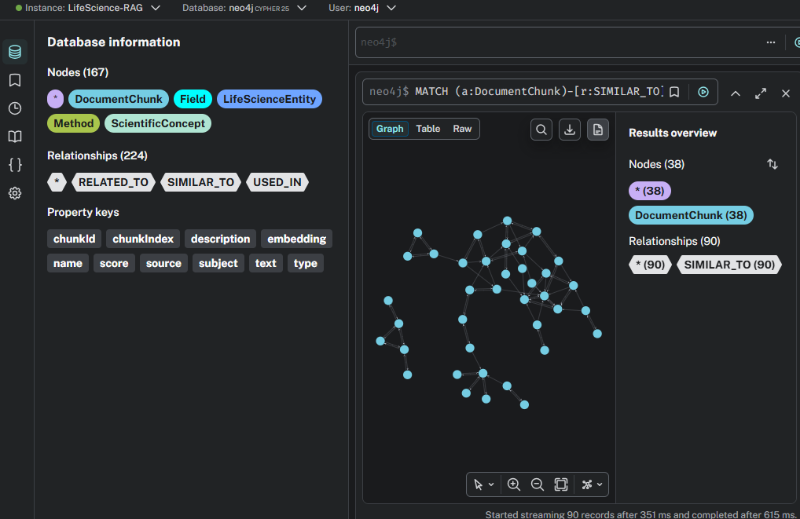

  Graph RAG:

  - ScientificConcept: indeholder faglige begreber
  - RELATED_TO: Forbinder begreberne
  - type: angiver den specifikke relation mellem begrebene

  Databasen indeholder 50 DocumentChunk-noder og 132 RELATED_TO-relationer samt 2 USED_IN-relationer. Derudover er der oprettet 90 SIMILAR_TO-relationer mellem tekststykkerne for at visualisere semantisk lighed.

  Billedet viser 27 ScientificConcept-noder og 21 RELATED_TO-relationer mellem faglige begreber i Neo4j.

  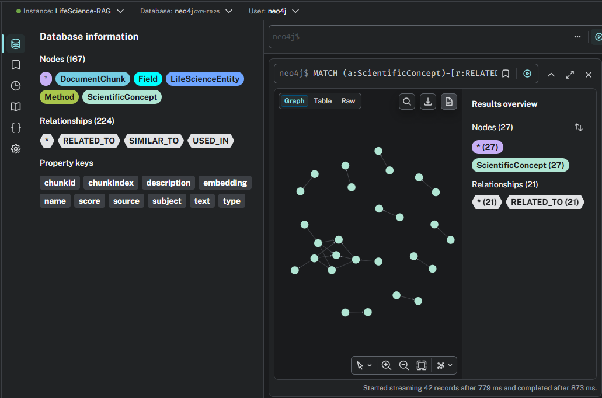

 ## Test - svar:

### Test 1 – Graph RAG:Spørgsmål:  What is analytical chemistry related to?

 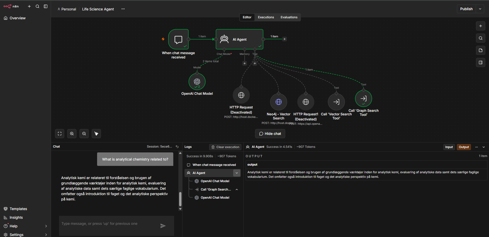

 **Vurdering:**

Agenten anvendte Graph Search Tool til at finde relationer mellem
faglige begreber i Neo4j.

Agenten svarede med en beskrivelse af analytisk kemi og relaterede
begreber fra databasen.

**Begrænsning:** Svaret er forholdsvis generelt og forklarer ikke
relationerne mellem begreberne særlig detaljeret.

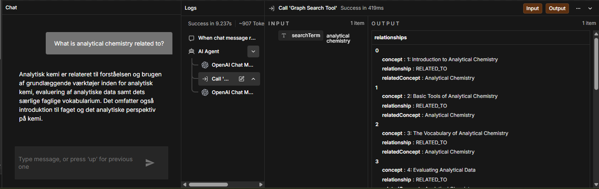


 ### Test 2 - Vector RAG : Spørgsmål: What is gravimetric analysis, and how is it used to determine the amount of nickel?

 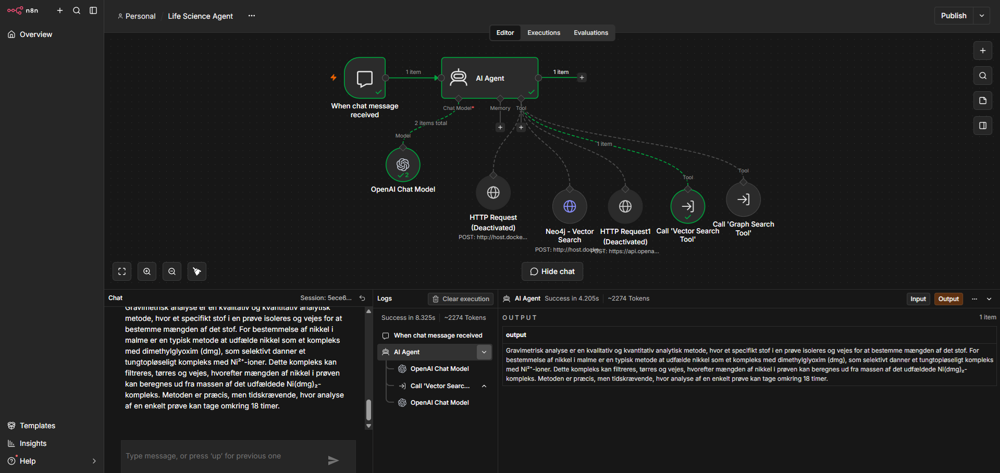

 **Vurdering:**

Agenten anvendte Vector Search Tool til at finde relevante tekststykker
fra lærebogen ved hjælp af semantisk søgning i Neo4j.

Agenten forklarede gravimetrisk analyse og beskrev, hvordan nikkel
kan bestemmes ved hjælp af dimethylglyoxim (dmg).

**Begrænsning:** Svaret beskriver metoden, men indeholder ikke
en detaljeret beregning af nikkelindholdet.

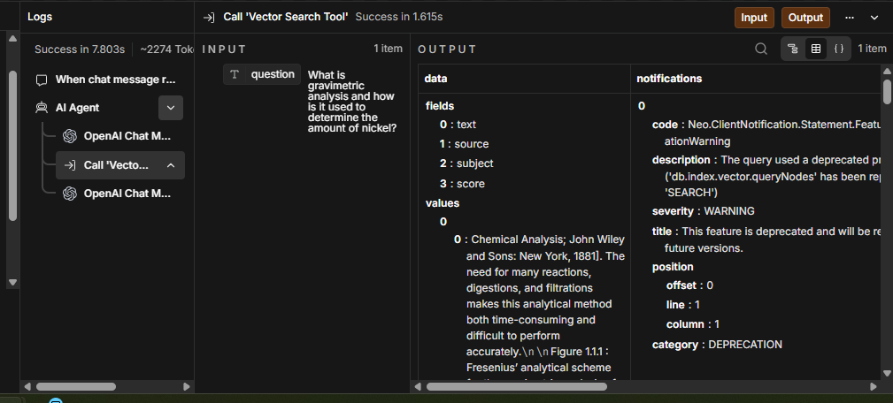

 ### Test 3 – Vector RAG og Graph RAG: spørgsmål: What is analytical chemistry, which concepts is it related to, and what does the textbook explain about its methods? Use both vector search and graph search.

 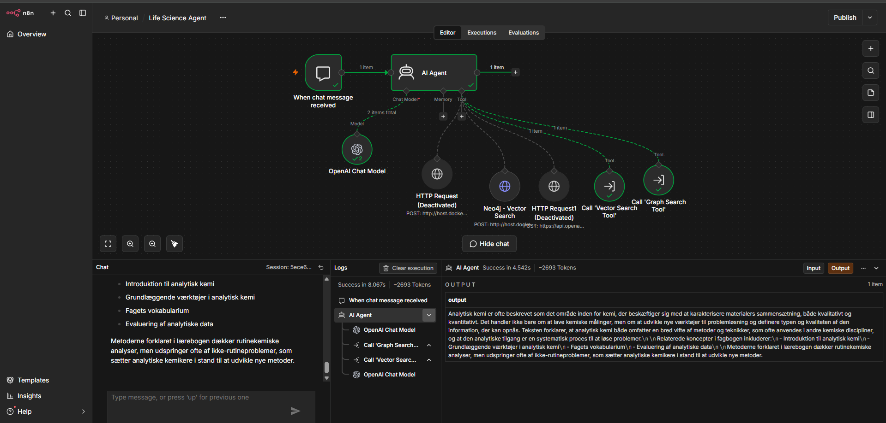

 **Vurdering:**

Agenten anvendte både Vector Search Tool og Graph Search Tool til at
besvare spørgsmålet.

Graph Search Tool fandt relaterede begreber inden for analytisk kemi,
mens Vector Search Tool fandt relevante tekststykker fra lærebogen.

Agenten kombinerede informationerne og forklarede både, hvad analytisk
kemi handler om, og hvilke emner og metoder lærebogen beskriver.

**Begrænsning:** Svaret er forholdsvis generelt, og sammenhængen mellem
de fundne begreber og lærebogens indhold kunne være forklaret mere præcist.

 
 ## Workflows:

 ### Life Science Agent:

 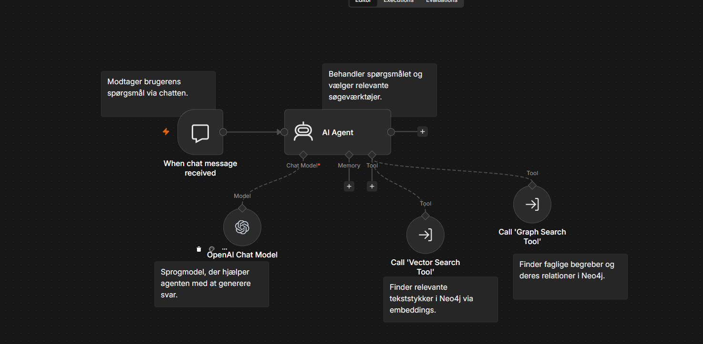

 ### Graph Search Tool:

 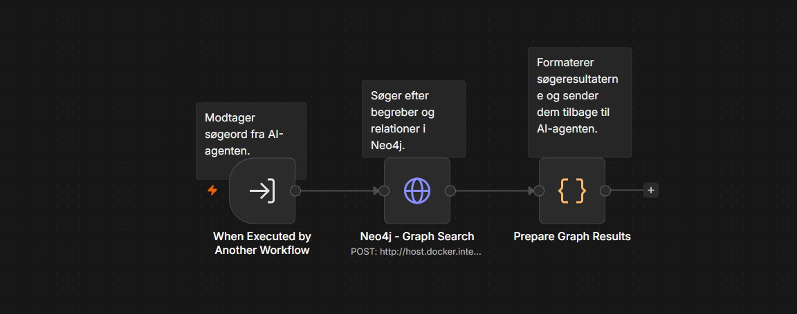

 ### Vector Search Tool:

 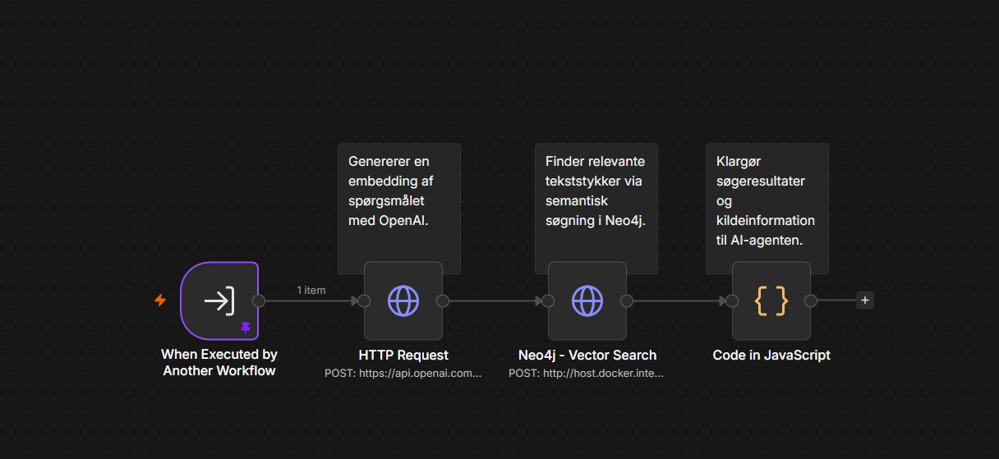

 ### Graph Ingestion:

 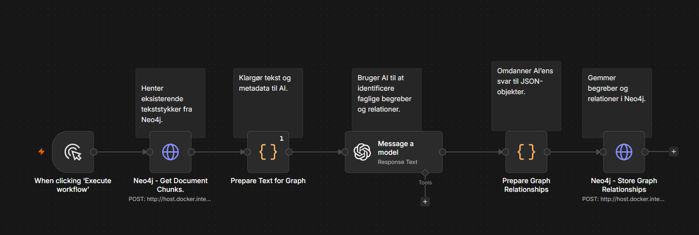

 ### Data ingestion:

 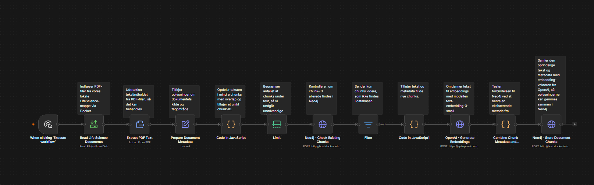


## Opsætning

1. Start n8n og Neo4j.
2. Importér de fem JSON-filer fra mappen `workflows` i n8n.
3. Opret forbindelser til Neo4j og OpenAI.
4. Tilføj PDF-filen og tilpas filstien i Data Ingestion.
5. Kør Data Ingestion og derefter Graph Ingestion.
6. Åbn Life Science Agent og test agenten via chatten.

Neo4j anvendes til både lagring af embeddings og relationer
mellem faglige begreber.

### Neo4j Vector Index

Projektet anvender et vector index i Neo4j til semantisk søgning.

- Navn: `document_chunk_vector_index`
- Node: `DocumentChunk`
- Property: `embedding`
- Dimensioner: 1536
- Similarity: COSINE

Indekset kan oprettes med følgende Cypher-query:

```cypher
CREATE VECTOR INDEX document_chunk_vector_index IF NOT EXISTS
FOR (c:DocumentChunk)
ON (c.embedding)
OPTIONS {
  indexConfig: {
    `vector.dimensions`: 1536,
    `vector.similarity_function`: 'cosine'
  }
};
```


